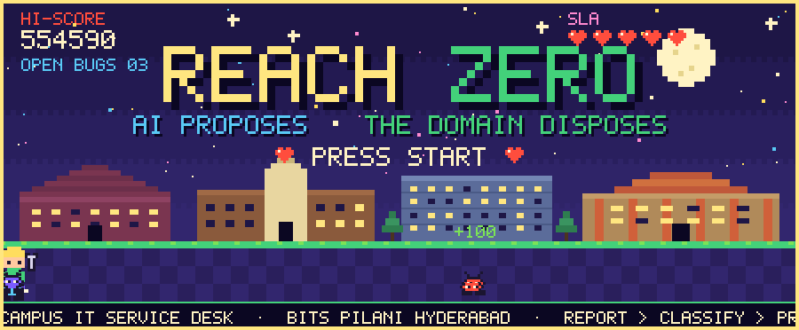
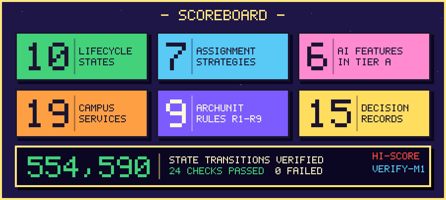
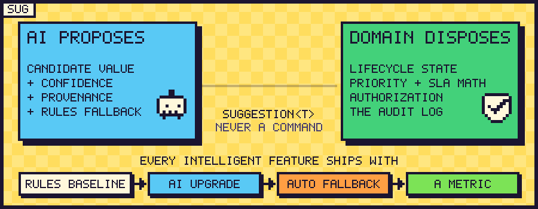
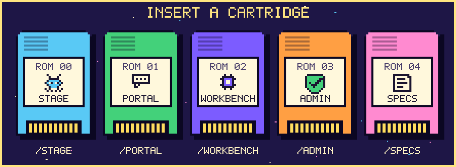
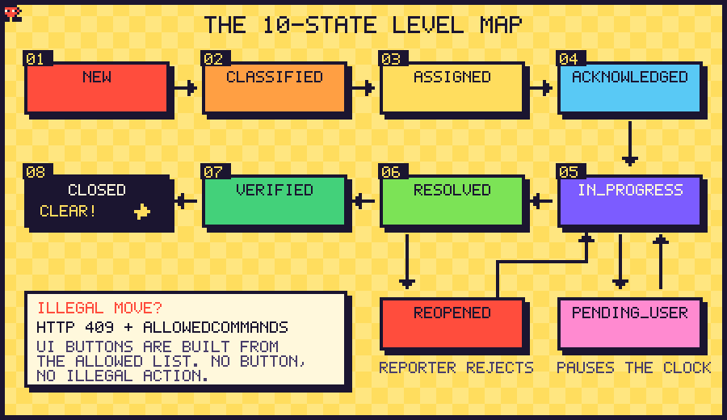
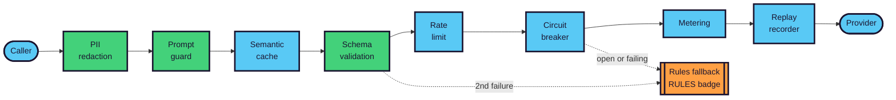
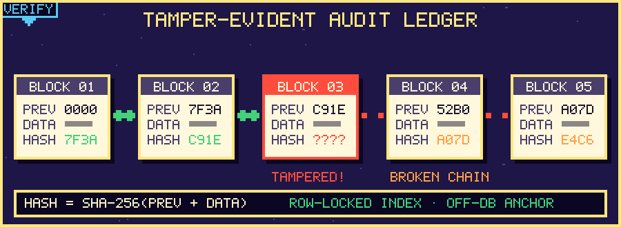
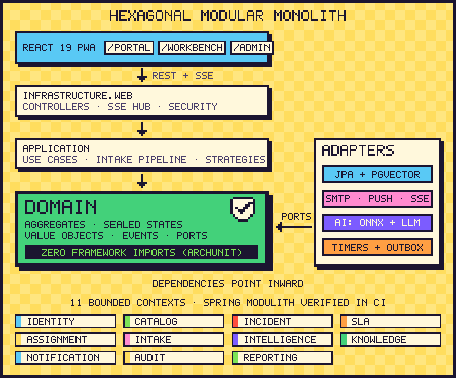

<div align="center">

<picture>
  <source media="(prefers-color-scheme: dark)" srcset="./logo/incident-zero-logo-light.png">
  <source media="(prefers-color-scheme: light)" srcset="./logo/incident-zero-logo.png">
  
</picture>



<br>

**An arcade-styled, AI-assisted incident management platform for campus IT.**
<br>
Report · Classify · Prioritize · Assign · Investigate · Resolve · Verify · Close

<br>


[**Play**](#-quick-start) &nbsp;·&nbsp; [**The rule**](#-the-governing-rule) &nbsp;·&nbsp; [**Cartridges**](#-pick-your-cartridge) &nbsp;·&nbsp; [**Lifecycle**](#-the-lifecycle) &nbsp;·&nbsp; [**Intelligence**](#-intelligence) &nbsp;·&nbsp; [**Architecture**](#-architecture) &nbsp;·&nbsp; [**Docs**](#-docs)

</div>

<br>

> ### *"AI proposes, the deterministic domain core disposes."*



<br>

## 🎮 What is Incident-Zero?

**Incident-Zero (I-ITSM)** is a campus IT service desk built for **BITS Pilani, Hyderabad Campus**. It manages the *entire* incident lifecycle (report, classify, prioritize, assign, investigate, resolve, verify, close) with intelligence at every stage.

It is deliberately small to operate:

- **one** Java modular monolith
- **one** React app with **three** role-specific workspaces
- **one** PostgreSQL database (relational data, full-text search *and* 384-d vector embeddings)

The UI is a love letter to the arcade: tickets are **pixel bugs** crawling over real campus landmarks, the technician is the **player**, SLAs are **ticking hearts**, workspaces are swappable **ROM cartridges**, and the audit trail is a **cryptographic hash spine** you can tamper-test with a keystroke. Underneath, it is strict, compiler-checked engineering.

<br>

## 🧬 The governing rule



AI output is **always a candidate value with a confidence and provenance**, never a command. Only domain code is allowed to change lifecycle state, compute priority, do SLA arithmetic, authorize actions and write the audit log.

Every intelligent feature ships with the same four things:

| 1. Rules baseline | 2. AI upgrade | 3. Automatic fallback | 4. A metric |
| :---: | :---: | :---: | :---: |
| A deterministic implementation that always works | Same interface, smarter engine | Circuit open or model down? Rules answer in milliseconds | A harness that shows whether the upgrade actually helped |

This isn't a guideline, it's enforced: ArchUnit rule **R6** forbids the `intelligence` module from touching any command service or state mutation, so *"AI proposes, domain disposes"* is a **compile-and-CI fact**. A **kill-the-LLM test** runs in CI to prove every flow survives with the model switched off.


## 👾 Pick your cartridge



One React 19 PWA, five swappable cartridges:

| ROM | Route | Player | What happens there |
| :---: | :--- | :--- | :--- |
| **00** | `/stage` | Everyone | Interactive campus overworld: bugs crawl over BPHC landmarks, the technician squashes them, combo multiplier, 10-state rules board, live SHA-256 avalanche editor |
| **01** | `/portal` | Reporters (students, faculty) | AI intake copilot (text and voice), instant duplicate deflection, live status, one-click verify or reject |
| **02** | `/workbench` | On-call technicians | Live SSE queue, boss-fight incident detail, dual SLA chronometers, action bar built *only* from backend `allowedCommands`, war room, post-incident editor |
| **03** | `/admin` | IT governance | KPI grid, 19-node service dependency graph, audit-ledger verifier, 40-ticket storm simulator, dispatch weight sliders, demo clock |
| **04** | `/specs` | Reviewers | Formal spec of the state machine, row versioning, SLA stasis, topological sort and the hash spine |

**Game feel:** every blip, chirp and victory fanfare is synthesized live with the Web Audio API (zero audio files). There are **four skies** (day, sunset, night, monsoon) and the logo swaps itself to match. Illegal moves buzz and shake the screen.

<details>
<summary><b>🎬 Three demo levels</b></summary>

<br>

1. **Level 1: Employee copilot intake.** Describe an outage in plain words (or dictate it); the copilot fills the diagnostic slots, shows similar incidents and self-help before you submit.
2. **Level 2: Technician war room.** Acknowledge, investigate, pause the clock with *request user info*, resume, resolve, then **tamper with the audit table in SQL** and watch the verifier catch it.
3. **Level 3: The boss fight.** A 40-ticket `ERP_LDAP_POOL_EXHAUSTION` storm hits. Duplicates collapse under a master incident, the system declares a **major incident**, batch assignment kicks in, and root-cause ranking highlights the likely culprit on the dependency graph.

</details>


## 🐛 The lifecycle



- **10 states** (the classic eight plus `PENDING_USER` and `REOPENED`) modelled as a **sealed `IncidentState` hierarchy**. Lifecycle behaviour lives in state classes, not in `if/else` on a status string.
- `SLA_VIOLATED` is *not* a status. A breached ticket is still `IN_PROGRESS`; breach is an orthogonal `slaStatus` (`ON_TRACK`, `AT_RISK`, `BREACHED`).
- **Illegal transitions** return **HTTP 409** (`ITSM-4090`) with `incidentId`, `currentState`, `attemptedCommand` and `allowedCommands`. The UI draws its buttons from that list, so a button for an illegal action simply doesn't exist.
- **Duplicates become children** of a master incident. Resolving the master resolves its children, releases their technician capacity and cancels their timers, while every reporter still verifies or rejects independently.
- **Major-incident override:** 200+ affected users, **or** 10+ linked reports in 15 minutes, **or** a core (T0) service at campus impact → forced **P1**, an incident commander and a war-room view.

<details>
<summary><b>📋 Command → transition table</b></summary>

<br>

| Command | From | To | Notes |
| :--- | :--- | :--- | :--- |
| `classify` | NEW | CLASSIFIED | category, priority and SLA snapshot present |
| `assign` | CLASSIFIED | ASSIGNED | assignee on shift and under capacity; atomic load reservation |
| `acknowledge` | ASSIGNED | ACKNOWLEDGED | stops the **response** clock |
| `startInvestigation` | ACKNOWLEDGED, REOPENED | IN_PROGRESS | |
| `requestUserInfo` | IN_PROGRESS | PENDING_USER | **pauses** the resolution clock, 24 h reminder |
| `provideUserInfo` | PENDING_USER | IN_PROGRESS | reporter reply stored as a public comment |
| `resolve` | IN_PROGRESS | RESOLVED | resolution code + notes (20+ chars); root cause mandatory for P1/P2 |
| `verify` | RESOLVED | VERIFIED | reporter, or system after 72 h of silence |
| `rejectResolution` | RESOLVED | REOPENED | reason required; new response target is 25% of the original |
| `close` | VERIFIED | CLOSED | P1/P2 need a recorded root cause; stops all clocks |

Plus `reassign`, `linkAsChild`, `unlinkFromMaster`, `resolveWithMaster`, `declareMajor` and the `cancel` extension (which doubles as the live demo of adding a state).

</details>

<br>

## ⏰ Priority, SLA and escalation

**Priority is explainable, not magic.** The default is the ITIL impact × urgency matrix, followed by four bounded, individually logged modifiers (service tier, affected users, active calendar window like exams or fee deadlines, and a floor for security incidents). The whole chain is stored and shown in a **"Why P1?"** panel.

| Impact ＼ Urgency | 1 Low | 2 Medium | 3 High |
| :--- | :---: | :---: | :---: |
| **3 · Campus** | 🟨 P3 | 🟧 P2 | 🟥 P1 |
| **2 · Group** | 🟩 P4 | 🟨 P3 | 🟧 P2 |
| **1 · Individual** | 🟩 P4 | 🟩 P4 | 🟨 P3 |

- **Dual pause-aware SLA clocks** (`responseClock`, `resolutionClock`) with business-calendar arithmetic (Mon–Fri 09:00–18:00 IST, holiday table). P1/P2 on core services run 24×7.
- **Escalation ladder** (Chain of Responsibility): Technician → Team Lead → System Admin → IT Manager, firing at 1.0×, 1.5× and 2.0× of the response target. A P1 with a 5-minute target escalates at **5, 7.5 and 10 minutes**.
- **Demo clock:** a `VirtualAnchoredClock` runs the whole system at up to **30×**, so a 30-minute P1 resolution target ticks out in **60 real seconds**, with timers, SSE gauges and the DelayQueue all staying in sync.
- **Time is injected.** Domain and application code may never call `Instant.now()` or `new Random()` (ArchUnit **R5**), which is exactly what lets the simulator and demo clock control time.

<details>
<summary><b>⏱ SLA policy matrix (response / resolution, minutes)</b></summary>

<br>

| Priority | T0 core services | T1 important apps | T2 supporting | T3 individual / hardware |
| :--- | :---: | :---: | :---: | :---: |
| **P1** | 5 / 30 | 5 / 30 | 10 / 60 | 15 / 120 |
| **P2** | 10 / 90 | 15 / 120 | 30 / 240 | 60 / 480 |
| **P3** | 30 / 360 | 60 / 480 | 120 / 720 | 240 / 1440 |
| **P4** | 120 / 960 | 240 / 1440 | 480 / 2880 | 480 / 4320 |

Calendar windows stack through Decorators on the policy (e.g. an exam window halves P1/P2 targets). Decorators change the *targets*; the `BusinessCalendar` does the *clock arithmetic*. Two jobs, kept separate.

</details>

<details>
<summary><b>⚖ Alternate priority strategies (kept for comparison)</b></summary>

<br>

`ProductScorePriorityStrategy` (impact × urgency × criticality) and `WeightedScorePriorityStrategy` ship next to the ITIL matrix and are compared with Cohen's κ. The product score is a cautionary tale: `2×3×1` and `1×2×3` both equal 6, a collision that the matrix avoids by construction.

</details>

<br>

## 🎯 Assignment

Seven pluggable `AssignmentStrategy` classes, switchable at runtime from the Admin UI (the list is read from the registry, so a new strategy appears with zero UI changes):

`RoundRobin` · `LeastLoaded` · `SkillMatch` · `Experience` · `PriorityAware` · **`HybridWeighted`** (default) · **`HungarianBatch`** (storm mode)

```text
score = 0.40·skillMatch + 0.25·(1 − loadRatio) + 0.20·experience + 0.15·speed
```

- Every term is bounded to `[0, 1]` with **cold-start and divide-by-zero guards** (Bayesian-smoothed speed, so a brand-new technician gets a neutral score, not a `NaN`).
- **Storm mode** buffers tickets and solves a **Kuhn–Munkres** optimal matching with marginal-capacity slot gating.
- **No race conditions:** capacity is reserved with an atomic SQL guard (`points + :w <= capacity`), never a read-then-write check.
- Every decision carries an **explanation object**, so technicians see *why* they were picked.


## 🧠 Intelligence

Six shipped intelligent features (Tier A), each with a rules baseline sitting right beside its AI upgrade:

| | Feature | Rules baseline | AI upgrade |
| :---: | :--- | :--- | :--- |
| **A1** | Duplicate and related-incident linking | Lexical matching | **Hybrid RRF:** pgvector HNSW + `tsvector` GIN fused in one query |
| **A2** | Categorisation, service linking, impact | Alias and keyword rules | Embedding kNN (k=7), with an LLM extractor only when confidence is under 0.6 |
| **A3** | Explainable priority | ITIL matrix | Four bounded modifiers, each logged as a step |
| **A4** | Technician recommendation | Round-robin, least-loaded | Hybrid weighted score + Hungarian batch |
| **A5** | SLA breach risk and early escalation | Elapsed ÷ target threshold bands | **Calibrated GBDT exported to ONNX**, landmark-based; risk ≥ 0.7 escalates early |
| **A6** | Suggested resolution | kNN list of similar fixes | **Case-based RAG** with a deterministic citation verifier |

**Innovation features (Tier B):**

- **B1 · Service-desk copilot:** chat and voice intake that fills diagnostic slots, asks at most two clarifying questions and shows deflection before you submit.
- **B2 · Storm simulator and root-cause ranking** *(hero demo)*: a live 19-service dependency graph with a leaf-safe RCA score (coverage − unexplained penalty + onset timing + tier). The LLM only *writes the explanation*; a verifier checks every service and incident ID it mentions, and the ranker **abstains** when it isn't sure.
- **B3 · Post-incident review:** blameless PIR and KB drafts generated from the audit facts only; any timestamp not in the facts table is rejected.
- **B4 · Natural-language search:** compiled to a validated, composable `Specification` over a closed vocabulary. **Never SQL.**
- **B5 · MCP server:** read-only tools, write proposals need UI approval *(time-boxed spike)*.

### The AI gateway

Every LLM call walks the same decorator chain around a provider-neutral `LanguageModelPort`:



- **Offline-first.** Embeddings (`all-MiniLM-L6-v2`, 384-d) and the SLA-risk model run **in-process via ONNX Runtime**. Python is used only offline for data generation and training (`/ml`). The LLM is a hosted provider, local Ollama, or **recorded Replay fixtures**, so CI and demos run with no internet.
- **Guardrails** follow the OWASP LLM Top 10: PII is masked before anything leaves, user text is wrapped as untrusted data, output must match closed-vocabulary schemas, retrieval is filtered by the caller's role, and prompts contain no secrets or SLA numbers.
- **Failure is designed in.** LLM down, slow, malformed JSON, low confidence, prompt-injection payload, missing model file, missing pgvector: each ends in a *working* incident flow with a small **Rules** badge, never a 500.
- Every suggestion lands in an `ai_suggestion` table that doubles as audit evidence, a feedback loop (accepted and overridden values feed the kNN index immediately) and an evaluation set.
- **Honest numbers:** no figure appears in the docs unless our own committed harness (`/ml/eval`, time-split data, bootstrap CIs) produced it.

<br>

## 🔐 Tamper-evident audit



- Every state change appends to a **SHA-256 hash-chained** `audit_record` ledger. Edit or delete a row in SQL and every later block fails verification.
- Appends use a **row-locked index** plus a **daily off-database anchor**, so a silent rewrite of history can't be hidden by recomputing the chain.
- Audit rows commit **in the same ACID transaction** as the state change (rule **R9**: synchronous in-transaction listeners, never after-commit ones), so state, audit and SLA timers succeed or roll back together.
- Verify it live from the Admin cartridge, or break it yourself in Level 2 of the demo.


## 🧱 Architecture



A **hexagonal modular monolith** on Spring Boot and Spring Modulith. Dependencies point inward: the domain defines ports (`IncidentRepository`, `Notifier`, `LanguageModelPort`, `EmbeddingPort`, `ClockPort`), and infrastructure implements them. Domain classes are plain Java; JPA entities live only in infrastructure.

<details>
<summary><b>🛡 The nine CI-enforced architecture rules (ArchUnit + Modulith <code>verify()</code>)</b></summary>

<br>

| Rule | Guarantee |
| :---: | :--- |
| **R1** | Domain imports nothing from Spring, JPA, Hibernate or Jackson |
| **R2** | Application layer imports no JPA, servlet or infrastructure packages |
| **R3** | Modules talk only through each other's `api` package |
| **R4** | Controllers never touch repositories |
| **R5** | No `Instant.now()`, `UUID.randomUUID()` or `new Random()` in domain/application (use injected ports) |
| **R6** | `intelligence` can't call command services or mutate state: it only returns `Suggestion<T>` |
| **R7** | Port interfaces live in domain/api; every adapter lives in infrastructure |
| **R8** | Constructor injection only, no field injection anywhere |
| **R9** | Audit and SLA-timer listeners are in-transaction (`MANDATORY`), never after-commit |

</details>

<details>
<summary><b>🧩 Design patterns, each tied to a named variation point</b></summary>

<br>

| Pattern | Where | Variation point it protects |
| :--- | :--- | :--- |
| **State** | sealed `IncidentState` hierarchy | lifecycle behaviour lives in classes, not `if/else` |
| **Strategy** | priority, assignment, duplicate detection, categorisation, SLA risk, resolution suggestion | swap an algorithm at runtime; every AI upgrade sits beside its baseline |
| **Observer** | domain events → audit, notification, SLA timer, live feed, escalation listeners | add a side effect without touching the publisher |
| **Chain of Responsibility** | escalation handlers | reorder or insert tiers through data |
| **Factory / Builder** | `IncidentFactory`, `NotificationFactory`, `UserFactory` | one place enforces creation invariants |
| **Adapter** | notification channels, LLM providers, embeddings | a new channel or provider is one new class |
| **Repository** | JPA and in-memory implementations | swap persistence; millisecond unit tests |
| *Bonus* | Decorator (AI gateway, SLA policies), Specification (search), Template Method (intake steps), Composite (service tree) | |

</details>

<details>
<summary><b>📈 The 100× scale story: four pre-engineered seams</b></summary>

<br>

1. **Stateless JWT + Redis SSE bus** for multi-node fan-out
2. **Monthly range-partitioned** `incident` and `audit_record`, plus read replicas
3. **Kafka outbox swap** behind the existing transactional outbox
4. **`tenant_id` with Postgres row-level security** for multi-tenancy

Redis, Kafka, Kubernetes and RLS are deliberately *out* of v1: a single instance needs none of them, and each has a documented seam instead.

</details>

<br>

## 🧰 Tech stack

| Layer | Pick |
| :--- | :--- |
| **Backend** | Java 21 LTS (auto-selects Java 25 under a JDK 25 Maven profile), Spring Boot 3.5, Spring Modulith, Spring Data JPA, Flyway |
| **Database** | PostgreSQL 16 + **pgvector** (HNSW) + `tsvector` (GIN) |
| **AI** | ONNX Runtime (in-process embeddings and SLA-risk model), provider-neutral LLM port with Replay and offline modes |
| **Resilience** | Resilience4j (circuit breaker), Bucket4j (rate limiting) |
| **Frontend** | React 19, TypeScript, Vite, Tailwind, React Flow (`@xyflow/react`), Three.js / React Three Fiber, Web Audio |
| **Quality** | JUnit 5, ArchUnit, Spring Modulith verification, six `verify-m*.sh` gates |
| **DevOps** | Docker Compose, GitHub Actions, Mailpit (dev email) |

> **Note on versions:** the master plan targets Java 25 and Spring Boot 4.1 with a documented fallback to Java 21 and Boot 3.5. The domain core is framework-free, so only adapters change. The current build uses the fallback and keeps a `jdk25` Maven profile ready.

<br>

## 🚀 Quick start

**Option A: local dev** (backend on `:8080`, frontend on `:3000`)

```bash
git clone https://github.com/srijans123/IncidentZero.git
cd IncidentZero

cp .env.example .env        # fill in your database and auth secrets
./start.sh                  # on Windows: start.bat
```

Requires JDK 21+, Maven 3.9+ and Node 18+.

**Option B: Docker Compose**

```bash
# Postgres (pgvector) + Mailpit only: pair with start.sh
docker compose -f deploy/docker-compose.yml up -d db mailpit

# Full stack: database, mail catcher, backend and frontend
docker compose -f deploy/docker-compose.yml --profile demo up --build
```

| Service | URL |
| :--- | :--- |
| Frontend (compose) | http://localhost:5173 |
| Frontend (`start.sh`) | http://localhost:3000 |
| API | http://localhost:8080 |
| Mailpit (caught emails) | http://localhost:8025 |

The compose demo runs AI in deterministic **`replay`** mode by default (`AI_PROVIDER=replay`), so everything works offline. Use the **role switcher** in the header to hop between an employee, a technician and an administrator.

### 🧪 Run the verification gates

```bash
bash scripts/verify-m1.sh   # pure-JDK state machine harness: 554,590 transitions
bash scripts/verify-m2.sh   # Flyway migrations + campus seed + ArchUnit R1-R9
bash scripts/verify-m3.sh   # intake pipeline
bash scripts/verify-m4.sh   # AI platform in replay and off modes
bash scripts/verify-m5.sh   # REST, SSE and backend test suite
bash scripts/verify-m6.sh   # React 19 type-check and production build
```

<br>

## 📁 Repo map

```text
IncidentZero/
├── backend/      Spring Boot modular monolith (domain · application · infrastructure per module)
├── frontend/     React 19 PWA: /stage /portal /workbench /admin /specs
├── ml/           offline training and ONNX export (train_sla_risk.py)
├── scripts/      verify-m1 … verify-m6 gates
├── deploy/       docker-compose, Dockerfiles, nginx
├── docs/         ADR-001 … ADR-015, design notes, README art
├── logo/         brand logos (navy for light skies, cream for dark skies)
└── .github/      CI workflows
```

<br>

## 📚 Docs

| Doc | What's inside |
| :--- | :--- |
| [`PRD.md`](./PRD.md) | Product requirements |
| [`PRODUCT.md`](./PRODUCT.md) | Personas, platform and governing principle |
| [`DESIGN.md`](./DESIGN.md) | The pixel-arcade design system: palette, type, skies, sound, cartridges |
| [`incident_zero_master_implementation_procedure_v2_2.md`](./incident_zero_master_implementation_procedure_v2_2.md) | The master plan: decisions, domain model, algorithms, schema, tests, schedule |
| [`docs/adr/`](./docs/adr) | **15 Architecture Decision Records** (language, topology, database, AI runtime, SSE, OOP, lifecycle, priority, assignment, guardrails, evaluation, testing, audit, scale, frontend) |
| [`docs/AUTH_AND_DATABASE.md`](./docs/AUTH_AND_DATABASE.md) | Auth bridge and database setup |

<br>

## 📜 The rules of the game

1. **The domain ring has zero framework imports.** ArchUnit enforces it in CI.
2. **AI proposes, the domain disposes.** Every AI feature has a baseline, a fallback and a metric, and the kill-the-LLM test passes in CI.
3. **No number without a harness.** Nothing is quoted in docs, video or resume unless our own evaluation produced it.
4. **Every pattern names its variation point,** and every extensibility claim has a real diff behind it.
5. **Docs-as-code,** updated the week a decision is made.

<br>


<div align="center">

Built at **BITS Pilani, Hyderabad Campus** by [@srijans123](https://github.com/srijans123) and team.
<br>
<sub>The pixel art in this README is generated from code: see <code>tools/readme-art</code>.</sub>

</div>
